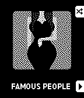

<!-- Generated by scripts/update_app_directory.py: do not edit by hand -->
[← All Pebble Developers](../developers.md)

# Alegrium

*1 app · Last updated 2026-10-12 · [About these lists](../about-app-lists.md)*

Links: [Pebble App Store](https://apps.repebble.com/apps/dev/alegrium_53246842a072ac5e9d000102)

<h2 class="app-name" id="app-53246928fec90d583c0000b2"><a href="https://apps.repebble.com/53246928fec90d583c0000b2">Icon Pop Quiz</a> v1.0.2</h2>
<a class="app-source" href="http://www.alegrium.com/" title="Source code" data-search-exclude>View source</a>

App

Released 2014-03-15 Updated 2014-03-28

Runs on: Time 2, Pebble 2 Duo, Pebble 2, Time, Classic

ICON POP Quiz challenges players to name famous characters using imaginative, handcrafted visual clues inspired by each answer. Can you guess all the icons?

