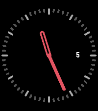
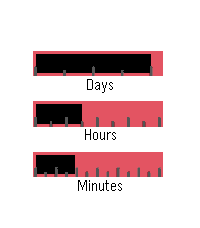

<!-- Generated by scripts/update_app_directory.py: do not edit by hand -->
[← All Pebble Developers](../developers.md)

# alekoz47

*4 watchfaces · Last updated 2026-10-11 · [About these lists](../about-app-lists.md)*

Links: [Rebble App Store](https://apps.rebble.io/en_US/developer/567b3f6337e090549c000075/1) · [GitHub (alekoz47)](https://github.com/alekoz47)

<button type="button" data-filter="all" aria-pressed="true">All 4</button><button type="button" data-filter="watchface" aria-pressed="false">Watchfaces 4</button><button type="button" data-filter="watchapp" aria-pressed="false" disabled>Apps 0</button>

<label class="dev-sort">Sort by <select><option value="updated">Recently updated</option><option value="released">Newest release</option><option value="title">A–Z</option></select></label>

<h2 class="app-name" id="app-5878ed5f5de8509ab500099a"><a href="https://apps.rebble.io/en_US/application/5878ed5f5de8509ab500099a">Hex Analog</a> v1.1</h2>
<a class="app-source" href="https://github.com/alekoz47/hex-analog" title="Source code" data-search-exclude>View source</a>

Watchface

GPL-3.0 Released 2017-01-13 Updated 2017-01-27 Rebble App Store

Runs on: Round 2, Time 2, Time Round, Time

A configurable analog watchface that changes color based on a hexadecimal mapping of the hours and minutes of the day.

<h2 class="app-name" id="app-5833003b8c7ffffa9800018a"><a href="https://apps.rebble.io/en_US/application/5833003b8c7ffffa9800018a">Simple</a> v3.0</h2>
<a class="app-source" href="https://github.com/alekoz47/simple" title="Source code" data-search-exclude>View source</a>

Watchface

GPL-3.0 Released 2016-11-21 Updated 2017-01-09 Rebble App Store

Runs on: Round 2, Time 2, Pebble 2 Duo, Pebble 2, Time Round, Time

A simple configurable analog watch face with tick marks and a date. Note: The default color scheme is white for Pebble 2HR watches. If your watch supports color, feel free to alter this in the…

<h2 class="app-name" id="app-586dbe32e09e6366150004b5"><a href="https://apps.rebble.io/en_US/application/586dbe32e09e6366150004b5">Hex Color</a> v3.2</h2>
<a class="app-source" href="https://github.com/alekoz47/hex-color" title="Source code" data-search-exclude>View source</a>

Watchface

GPL-3.0 Released 2017-01-05 Updated 2017-01-09 Rebble App Store

Runs on: Round 2, Time 2, Time Round, Time

A digital watchface that changes color based on a hexadecimal mapping of the hours and minutes of the day.

<h2 class="app-name" id="app-583b182600355aeba4000137"><a href="https://apps.rebble.io/en_US/application/583b182600355aeba4000137">Bars</a> v1.1</h2>
<a class="app-source" href="https://github.com/alekoz47/bars" title="Source code" data-search-exclude>View source</a>

Watchface

GPL-3.0 Released 2016-11-27 Updated 2016-11-28 Rebble App Store

Runs on: Round 2, Time 2, Time Round, Time

A simple watchface using loading bars to represent the time and date. The date is ticked by marks every 7 days, hours every 3, and minutes every 5.

