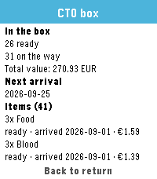

<!-- Generated by scripts/update_app_directory.py: do not edit by hand -->
[← All Pebble Developers](../developers.md)

# Alessio Biancalana

*1 app · Last updated 2026-10-11 · [About these lists](../about-app-lists.md)*

Links: [Pebble App Store](https://apps.repebble.com/apps/dev/alessio-biancalana_5c93bc49fc50bcdf9d3b3b0f) · [GitHub (dottorblaster)](https://github.com/dottorblaster)

<h2 class="app-name" id="app-01c0ce6bd4e540b4aecd70f4"><a href="https://apps.repebble.com/01c0ce6bd4e540b4aecd70f4">PebTrader Zero</a> v0.3.1</h2>
<a class="app-source" href="https://github.com/dottorblaster/pebtrader-zero" title="Source code" data-search-exclude>View source</a>

App

Released 2026-09-25 Updated 2026-09-25

Runs on: Round 2, Time 2

PebTrader Zero shows the state of your CardTrader Zero orders on your Pebble. • Your orders at a glance: state, item count, total and counterparty • Open an order for its timeline, totals…

