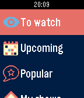

<!-- Generated by scripts/update_app_directory.py: do not edit by hand -->
[← All Pebble Developers](../developers.md)

# Alessio Bogon

*1 app · Last updated 2026-10-11 · [About these lists](../about-app-lists.md)*

Links: [Pebble App Store](https://apps.repebble.com/apps/dev/alessio-bogon_52fe8094e2d6411af5000399) · [GitHub (youtux)](https://github.com/youtux) · [Website (twitter.com)](http://twitter.com/youtux)

<h2 class="app-name" id="app-54efac282e6a4711130000dc"><a href="https://apps.repebble.com/54efac282e6a4711130000dc">Shows</a> v3.8</h2>
<a class="app-source" href="https://github.com/youtux/PebbleShows" title="Source code" data-search-exclude>View source</a>

App

Released 2015-02-26 Updated 2016-02-14

Runs on: Round 2, Time 2, Pebble 2 Duo, Pebble 2, Time Round, Time, Classic

Keep track of your TV shows on your Pebble! With this watchapp you can view what episodes you have to watch and what&#x27;s coming out in the next days. On your timeline, too! The watchapp needs to…

