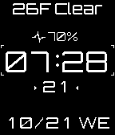

<!-- Generated by scripts/update_app_directory.py: do not edit by hand -->
[← All Pebble Developers](../developers.md)

# Alex Emashev

*1 watchface · Last updated 2026-10-12 · [About these lists](../about-app-lists.md)*

Links: [Pebble App Store](https://apps.repebble.com/apps/dev/alex-emashev_546b614be05288ab960000c6) · [GitHub (AlexEmashev)](https://github.com/AlexEmashev) · [Website (cgrey.deviantart.com)](http://cgrey.deviantart.com)

<h2 class="app-name" id="app-55e7080e6461817c68000020"><a href="https://apps.repebble.com/55e7080e6461817c68000020">Cyberage</a> v1.1</h2>
<a class="app-source" href="https://github.com/AlexEmashev/Cyberage" title="Source code" data-search-exclude>View source</a>

Watchface

MIT Released 2015-09-02 Updated 2015-10-21

Runs on: Time 2, Pebble 2 Duo, Pebble 2, Time, Classic

It&#x27;s a simple digital watch face with slight cyberpunk flavor. Available settings: °F or °C; 12h or 24h; mm/dd or dd/mm date format.

