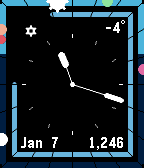

<!-- Generated by scripts/update_app_directory.py: do not edit by hand -->
[← All Pebble Developers](../developers.md)

# Alex Karantza

*1 watchface · Last updated 2026-10-11 · [About these lists](../about-app-lists.md)*

Links: [Rebble App Store](https://apps.rebble.io/en_US/developer/584c2477ce45dc59d0000129/1) · [GitHub (karantza)](https://github.com/karantza)

<h2 class="app-name" id="app-58711a922ee431238100057a"><a href="https://apps.rebble.io/en_US/application/58711a922ee431238100057a">Planets</a> v1.1</h2>
<a class="app-source" href="https://github.com/karantza/Planets_PebbleFace" title="Source code" data-search-exclude>View source</a>

Watchface

Released 2017-01-07 Updated 2017-01-09 Rebble App Store

Runs on: Time 2, Time

A digital or analog watchface to see what planets are in the sky. Includes a 24-hour weather forecast from Dark Sky, and step count, too.

