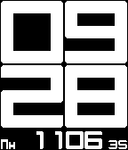

<!-- Generated by scripts/update_app_directory.py: do not edit by hand -->
[← All Pebble Developers](../developers.md)

# Alex Ky

*1 watchface · Last updated 2026-10-11 · [About these lists](../about-app-lists.md)*

Links: [Pebble App Store](https://apps.repebble.com/apps/dev/alex-ky_54775bfdb64bc9acc0000064) · [GitHub (Taran2ul)](https://github.com/Taran2ul)

<h2 class="app-name" id="app-54aa8254bda8735745000044"><a href="https://apps.repebble.com/54aa8254bda8735745000044">Revolution Russian</a> v1</h2>
<a class="app-source" href="https://github.com/Taran2ul/RevolutionRussian" title="Source code" data-search-exclude>View source</a>

Watchface

Other Released 2015-01-05 Updated 2015-01-05

Runs on: Time 2, Pebble 2 Duo, Pebble 2, Time, Classic

This is a variation from a reputable Pebble watchface Douwe Maan. Envisioned as a watchface by Jean-Noël Mattern (Jnm), who posted it in the &quot;Watch-face ideas&quot; thread on the Pebble forums. Based…

