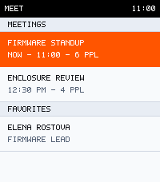

<!-- Generated by scripts/update_app_directory.py: do not edit by hand -->
[← All Pebble Developers](../developers.md)

# Alex Palson

*1 app · Last updated 2026-11-23 · [About these lists](../about-app-lists.md)*

Links: [Rebble App Store](https://apps.rebble.io/en_US/developer/6b022e6b0b3aa90008b45971/1) · [GitHub (senorsunday)](https://github.com/senorsunday)

<h2 class="app-name" id="app-6b023373566c71000974ca59"><a href="https://apps.rebble.io/en_US/application/6b023373566c71000974ca59">Google Meet Remote</a> v0.0</h2>
<a class="app-source" href="https://github.com/senorsunday/pebble-meet-watchapp" title="Source code" data-search-exclude>View source</a>

App · <a href="https://forum.rebble.io/t/1541" title="Discuss this app on the Rebble forum" data-search-exclude>Forum thread</a>

MIT Released 2026-11-22 Updated 2026-11-22 Rebble App Store

Runs on: Round 2, Time 2, Pebble 2 Duo, Pebble 2, Time Round, Time, Classic

Works as a configurable remote control for Google Meet. You can mute, turn off your camera, start and end calls from your watch.

