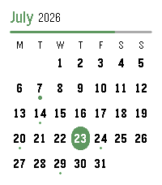

<!-- Generated by scripts/update_app_directory.py: do not edit by hand -->
[← All Pebble Developers](../developers.md)

# alex\_pavlov

*2 apps · Last updated 2026-10-11 · [About these lists](../about-app-lists.md)*

Links: [Pebble App Store](https://apps.repebble.com/apps/dev/alex-pavlov_5db8b4eb79e5620001a7e1ce) · [GitHub (alex523ap)](https://github.com/alex523ap)

<button type="button" data-filter="all" aria-pressed="true">All 2</button><button type="button" data-filter="watchface" aria-pressed="false" disabled>Watchfaces 0</button><button type="button" data-filter="watchapp" aria-pressed="false">Apps 2</button>

<label class="dev-sort">Sort by <select><option value="updated">Recently updated</option><option value="released">Newest release</option><option value="title">A–Z</option></select></label>

<h2 class="app-name" id="app-78408313eefa40f0bf30bc47"><a href="https://apps.repebble.com/78408313eefa40f0bf30bc47">Calendar for Pebble</a> v2.0.0</h2>
<a class="app-source" href="https://github.com/alex523ap/calendar-for-pebble" title="Source code" data-search-exclude>View source</a>

App

MIT Released 2026-06-14 Updated 2026-07-23

Runs on: Round 2, Time 2

A touch calendar watchapp for Pebble Time 2 and Pebble Round 2. Shows the month with a dot on every day that has events; tap a day for an agenda you can scroll through. Syncs from iCloud and…

<h2 class="app-name" id="app-cd7c4d5fe7ec4989a64976c6"><a href="https://apps.repebble.com/cd7c4d5fe7ec4989a64976c6">Playback for Spotify</a> v1.3</h2>
<a class="app-source" href="https://github.com/alex523ap/Playback-for-Spotify" title="Source code" data-search-exclude>View source</a>

App · <a href="https://forum.rebble.io/t/905" title="Discuss this app on the Rebble forum" data-search-exclude>Forum thread</a>

No licence Released 2026-04-12 Updated 2026-05-14

Runs on: Round 2, Time 2, Pebble 2 Duo, Pebble 2, Time Round, Time, Classic

Playback for Spotify Control Spotify from your wrist without reaching for your phone. Features -Now Playing: Track info, live progress bar, and album art (full color, dithered B&amp;W, or full-screen…

