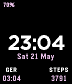

<!-- Generated by scripts/update_app_directory.py: do not edit by hand -->
[← All Pebble Developers](../developers.md)

# Alex

*1 watchface · Last updated 2026-10-11 · [About these lists](../about-app-lists.md)*

Links: [Pebble App Store](https://apps.repebble.com/apps/dev/alex_57411cb9b8bc1bf01c00001d) · [GitHub (alx-andru)](https://github.com/alx-andru) · [Website (alexandrugogan.com)](http://www.alexandrugogan.com/sleestack)

<h2 class="app-name" id="app-57411d17b8bc1b640e000017"><a href="https://apps.repebble.com/57411d17b8bc1b640e000017">Sleestack</a> v1.4</h2>
<a class="app-source" href="https://github.com/alx-andru/sleestack" title="Source code" data-search-exclude>View source</a>

Watchface

Apache-2.0 Released 2016-05-22 Updated 2016-07-18

Runs on: Round 2, Time 2, Pebble 2 Duo, Pebble 2, Time Round, Time, Classic

Simple, customizable, low power usage watchface. Match your pebble to what you&#x27;re wearing every day. A simple shake of your hand unveils for 2s the battery charge, a customizable, second timezone…

