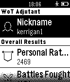
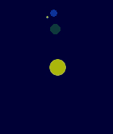

<!-- Generated by scripts/update_app_directory.py: do not edit by hand -->
[← All Pebble Developers](../developers.md)

# Alexander Kropochev

*1 watchface and 2 apps · Last updated 2026-10-11 · [About these lists](../about-app-lists.md)*

Links: [Pebble App Store](https://apps.repebble.com/apps/dev/alexander-kropochev_53c4cc43e524ad62230000b4) · [GitHub (kropochev)](https://github.com/kropochev) · [Website (kropochev.com)](http://kropochev.com)

<button type="button" data-filter="all" aria-pressed="true">All 3</button><button type="button" data-filter="watchface" aria-pressed="false">Watchfaces 1</button><button type="button" data-filter="watchapp" aria-pressed="false">Apps 2</button>

<label class="dev-sort">Sort by <select><option value="updated">Recently updated</option><option value="released">Newest release</option><option value="title">A–Z</option></select></label>

<h2 class="app-name" id="app-546e1e2813159fbb420000bb"><a href="https://apps.repebble.com/546e1e2813159fbb420000bb">WoT Adjutant</a> v1.2</h2>
<a class="app-source" href="https://github.com/kropochev/WoT-Adjutant" title="Source code" data-search-exclude>View source</a>

App

Released 2014-11-20 Updated 2025-11-25

Runs on: Time 2, Pebble 2 Duo, Pebble 2, Time, Classic

Watch your achievements the game World of Tanks with Pebble

<h2 class="app-name" id="app-541086d676c551c5790001f2"><a href="https://apps.repebble.com/541086d676c551c5790001f2">RPi-Monitor</a> v1.4</h2>
<a class="app-source" href="https://github.com/kropochev/RPi-Monitor-Pebble" title="Source code" data-search-exclude>View source</a>

App

Released 2014-09-10 Updated 2025-11-25

Runs on: Time 2, Pebble 2 Duo, Pebble 2, Time, Classic

App to monitor the status Raspberri Pi. Changelog of version 1.4: - Added support for basic authentication (Oscar R.C.) Important. You must install the RPi-Monitor…

<h2 class="app-name" id="app-556740d31034b0c062000033"><a href="https://apps.repebble.com/556740d31034b0c062000033">SpaceTime</a> v1.0</h2>
<a class="app-source" href="https://github.com/kropochev/SpaceTime" title="Source code" data-search-exclude>View source</a>

Watchface

Released 2015-05-28 Updated 2015-05-29

Runs on: Time 2, Pebble 2 Duo, Pebble 2, Time, Classic

I present to you the SpaceTime. In the center of the screen is the sun. Around the sun rotates the earth, which is the hour hand. Around the earth rotates, the moon and represents the minute hand…

