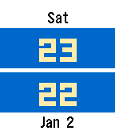

<!-- Generated by scripts/update_app_directory.py: do not edit by hand -->
[← All Pebble Developers](../developers.md)

# Alexander the Dev

*1 watchface · Last updated 2026-10-11 · [About these lists](../about-app-lists.md)*

Links: [Pebble App Store](https://apps.repebble.com/apps/dev/alexander-the-dev_567cbdd9209cace85800013f) · [GitHub (awhipp)](https://github.com/awhipp) · [Website (venturefocused.com)](https://venturefocused.com)

<h2 class="app-name" id="app-5688a058fd4a39a0ab000066"><a href="https://apps.repebble.com/5688a058fd4a39a0ab000066">The Nationalist</a> v1.1</h2>
<a class="app-source" href="https://github.com/awhipp/patriotic-watchface-pebble-time" title="Source code" data-search-exclude>View source</a>

Watchface

No licence Released 2016-01-03 Updated 2016-01-04

Runs on: Round 2, Time 2, Time Round, Time

The completely free watchface to support the country of your choice! Select the country. The watch face adjusts based on your national flag&#x27;s primary colors. Currently support exists for the…

