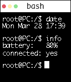

<!-- Generated by scripts/update_app_directory.py: do not edit by hand -->
[← All Pebble Developers](../developers.md)

# Alexandra DeLucia

*1 watchface · Last updated 2026-10-11 · [About these lists](../about-app-lists.md)*

Links: [Pebble App Store](https://apps.repebble.com/apps/dev/alexandra-delucia_56e35cfa2526c72e6600002e) · [GitHub (AADeLucia)](https://github.com/AADeLucia)

<h2 class="app-name" id="app-56f486d4acd389cf47000021"><a href="https://apps.repebble.com/56f486d4acd389cf47000021">Terminal</a> v1.0</h2>
<a class="app-source" href="https://github.com/AADeLucia/Pebble-Watchface-Terminal-Style.git" title="Source code" data-search-exclude>View source</a>

Watchface

No licence Released 2016-03-25 Updated 2017-01-14

Runs on: Time 2, Pebble 2 Duo, Pebble 2, Time, Classic

Terminal-style watchface for Unix enthusiasts! Features: -mimics a Mac/Linux terminal -shows date, time, battery status, and connection status -animated blinking cursor

