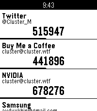
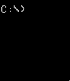
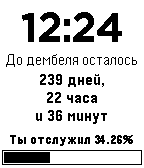
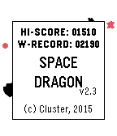

<!-- Generated by scripts/update_app_directory.py: do not edit by hand -->
[← All Pebble Developers](../developers.md)

# Alexey Cluster

*2 watchfaces and 2 apps · Last updated 2026-10-11 · [About these lists](../about-app-lists.md)*

Links: [Pebble App Store](https://apps.repebble.com/apps/dev/alexey-cluster_541d0dc59a11beda980000c8) · [Rebble App Store](https://apps.rebble.io/en_US/developer/541d0dc59a11beda980000c8/1) · [GitHub (ClusterM)](https://github.com/ClusterM) · [Website (cluster.wtf)](https://cluster.wtf)

<button type="button" data-filter="all" aria-pressed="true">All 4</button><button type="button" data-filter="watchface" aria-pressed="false">Watchfaces 2</button><button type="button" data-filter="watchapp" aria-pressed="false">Apps 2</button>

<label class="dev-sort">Sort by <select><option value="updated">Recently updated</option><option value="released">Newest release</option><option value="title">A–Z</option></select></label>

<h2 class="app-name" id="app-692194cf23bdbb000998b007"><a href="https://apps.repebble.com/692194cf23bdbb000998b007">TOPTer</a> v1.3</h2>
<a class="app-source" href="https://github.com/ClusterM/pebble-totper" title="Source code" data-search-exclude>View source</a>

App · <a href="https://forum.rebble.io/t/789" title="Discuss this app on the Rebble forum" data-search-exclude>Forum thread</a>

GPL-3.0 Released 2025-11-22 Updated 2026-03-23

Runs on: Round 2, Time 2, Pebble 2 Duo, Pebble 2, Time Round, Time, Classic

A powerful, standalone Time-based One-Time Password (TOTP) authenticator for Pebble smartwatches that doesn&#x27;t require a companion app on your phone. Features: - No Companion App Required: TOTPer…

<h2 class="app-name" id="app-552b7f4978b9ce9bb40000db"><a href="https://apps.repebble.com/552b7f4978b9ce9bb40000db">DOS Terminal Watchface</a> v1.2</h2>
<a class="app-source" href="https://github.com/ClusterM/pebble-dos" title="Source code" data-search-exclude>View source</a>

Watchface

No licence Released 2015-04-13 Updated 2016-09-26

Runs on: Time 2, Pebble 2 Duo, Pebble 2, Time, Classic

Simple DOS command line style watchface. Just like &quot;CMD TIME&quot; by Chris Lewis but with &quot;terminal&quot; font.

<h2 class="app-name" id="app-552b8b6bd6905f47ba0000df"><a href="https://apps.rebble.io/en_US/application/552b8b6bd6905f47ba0000df">Дембель Watchface</a> v1.1</h2>
<a class="app-source" href="https://github.com/ClusterM/pebble-dembel" title="Source code" data-search-exclude>View source</a>

Watchface

No licence Released 2015-04-13 Updated 2015-11-15 Rebble App Store

Runs on: Time 2, Pebble 2 Duo, Pebble 2, Time, Classic

Watchface for russian army. Для служащих в армии, показывает время оставшееся до дембеля. Обязательна прошивка с русскими шрифтами.

<h2 class="app-name" id="app-544e55029d8757daae000060"><a href="https://apps.repebble.com/544e55029d8757daae000060">Space Dragon</a> v2.3</h2>
<a class="app-source" href="https://github.com/ClusterM/space-dragon/" title="Source code" data-search-exclude>View source</a>

App

No licence Released 2014-10-27 Updated 2015-10-17

Runs on: Round 2, Time 2, Pebble 2 Duo, Pebble 2, Time Round, Time, Classic

Simple game. Tilt your watch to control the spaceship and avoid asteroids. Beat you own record! Be number one in online ratings! Press select button for a second to enable permanent backlight (but…

