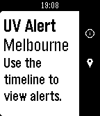

<!-- Generated by scripts/update_app_directory.py: do not edit by hand -->
[← All Pebble Developers](../developers.md)

# Alexey Kotlyarov

*1 app · Last updated 2026-10-11 · [About these lists](../about-app-lists.md)*

Links: [Pebble App Store](https://apps.repebble.com/apps/dev/alexey-kotlyarov_558a827fb0279c1c8700008e) · [GitHub (koterpillar)](https://github.com/koterpillar)

<h2 class="app-name" id="app-5610dd7d198996d1bc000076"><a href="https://apps.repebble.com/5610dd7d198996d1bc000076">UV Alert</a> v1.8</h2>
<a class="app-source" href="https://github.com/koterpillar/uv-alert" title="Source code" data-search-exclude>View source</a>

App

Released 2015-10-04 Updated 2016-08-06

Runs on: Round 2, Time 2, Pebble 2 Duo, Pebble 2, Time Round, Time, Classic

Timeline alerts for UV radiation levels in Australia, USA and Japan

