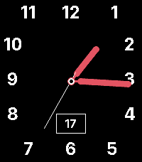
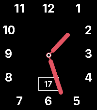

<!-- Generated by scripts/update_app_directory.py: do not edit by hand -->
[← All Pebble Developers](../developers.md)

# Alexis Ballo

*2 watchfaces · Last updated 2026-10-11 · [About these lists](../about-app-lists.md)*

Links: [Pebble App Store](https://apps.repebble.com/apps/dev/alexis-ballo_c70905f6b73f09634878474c) · [GitHub (AlexisBallo2)](https://github.com/AlexisBallo2)

<button type="button" data-filter="all" aria-pressed="true">All 2</button><button type="button" data-filter="watchface" aria-pressed="false">Watchfaces 2</button><button type="button" data-filter="watchapp" aria-pressed="false" disabled>Apps 0</button>

<label class="dev-sort">Sort by <select><option value="updated">Recently updated</option><option value="released">Newest release</option><option value="title">A–Z</option></select></label>

<h2 class="app-name" id="app-9573b80665544b23a3382ab5"><a href="https://apps.repebble.com/9573b80665544b23a3382ab5">Pear Hermit California</a> v1.0.1</h2>
<a class="app-source" href="https://github.com/AlexisBallo2/pear-hermit-ca-pebble" title="Source code" data-search-exclude>View source</a>

Watchface

No licence Released 2026-06-17 Updated 2026-06-17

Runs on: Time 2

Just removed the activity tracking from townmath&#x27;s pear hermit face. https://github.com/townmath/pear-hermit-ca-pebble. All credit to them

<h2 class="app-name" id="app-4e2b7dc2d4044030b28149c7"><a href="https://apps.repebble.com/4e2b7dc2d4044030b28149c7">Hermit Remix</a> v1.0.2</h2>
<a class="app-source" href="https://github.com/AlexisBallo2/pear-hermit-ca-pebble" title="Source code" data-search-exclude>View source</a>

Watchface

No licence Released 2026-06-17 Updated 2026-06-17

Runs on: Time 2

Just removed the activity tracking from townmath&#x27;s pear hermit face. https://github.com/townmath/pear-hermit-ca-pebble. All credit to them

