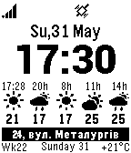

<!-- Generated by scripts/update_app_directory.py: do not edit by hand -->
[← All Pebble Developers](../developers.md)

# Alexsum

*1 watchface · Last updated 2026-10-12 · [About these lists](../about-app-lists.md)*

Links: [Pebble App Store](https://apps.repebble.com/apps/dev/alexsum_52d843161acbf3934c00001b) · [GitHub (alexsum)](https://github.com/alexsum) · [Website (pebblewatch.pw)](http://pebblewatch.pw/tcw/)

<h2 class="app-name" id="app-52fe1d0d3085a0848d000231"><a href="https://apps.repebble.com/52fe1d0d3085a0848d000231">TCW (Time, Calendar, Weather)</a> v2.52</h2>
<a class="app-source" href="https://github.com/alexsum/TCW" title="Source code" data-search-exclude>View source</a>

Watchface

GPL-3.0 Released 2014-02-14 Updated 2015-07-21

Runs on: Time 2, Pebble 2 Duo, Pebble 2, Time, Classic

Ru, Ua, En, Usr(lat+cyr) It shows: - two timezones - current time by two various fonts - calendar - weather in the current location or custom location: C and F, current and long-term forecasts …

