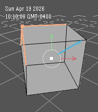

<!-- Generated by scripts/update_app_directory.py: do not edit by hand -->
[← All Pebble Developers](../developers.md)

# algebraicArt

*1 watchface · Last updated 2026-10-11 · [About these lists](../about-app-lists.md)*

Links: [Pebble App Store](https://apps.repebble.com/apps/dev/algebraicart_086cb2bed99747ad3255a8ae) · [GitHub (algebraicAdventures)](https://github.com/algebraicAdventures)

<h2 class="app-name" id="app-cc0764e6c456436887a073eb"><a href="https://apps.repebble.com/cc0764e6c456436887a073eb">Blendo</a> v1.2.1</h2>
<a class="app-source" href="https://github.com/algebraicAdventures/blender-pebble" title="Source code" data-search-exclude>View source</a>

Watchface

No licence Released 2026-04-19 Updated 2026-07-11

Runs on: Round 2, Time 2

Wear the default cube on your wrist! The cube rotates to point the selected vector towards the hour, and the blue gizmo arm points toward the minute.

