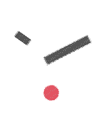

<!-- Generated by scripts/update_app_directory.py: do not edit by hand -->
[← All Pebble Developers](../developers.md)

# Algorythm

*1 watchface · Last updated 2026-10-12 · [About these lists](../about-app-lists.md)*

Links: [Pebble App Store](https://apps.repebble.com/apps/dev/algorythm_69de42ea8f0b7e00099137f9) · [GitHub (djeppers)](https://github.com/djeppers)

<h2 class="app-name" id="app-69e29adc4a2e3d0009e2f3e1"><a href="https://apps.repebble.com/69e29adc4a2e3d0009e2f3e1">Drift</a> v1.2.5</h2>
<a class="app-source" href="https://github.com/djeppers/drift_watchface" title="Source code" data-search-exclude>View source</a>

Watchface

No licence Released 2026-04-17 Updated 2026-05-12

Runs on: Round 2, Time 2, Pebble 2 Duo, Pebble 2, Time Round, Time, Classic

Inspired by Japanese wall clocks where the hands seem to hover above the face, casting soft shadows as they move. No numbers, no markers, no center point - just floating hands and a quiet red dot…

