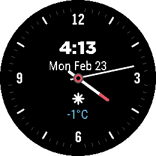

<!-- Generated by scripts/update_app_directory.py: do not edit by hand -->
[← All Pebble Developers](../developers.md)

# Ali Aslam

*1 watchface · Last updated 2026-10-11 · [About these lists](../about-app-lists.md)*

Links: [Pebble App Store](https://apps.repebble.com/apps/dev/ali-aslam_bcdc65fcb8fba074e9151351) · [GitHub (camr0)](https://github.com/camr0)

<h2 class="app-name" id="app-996a35fad5e243e1a7bf5eaa"><a href="https://apps.repebble.com/996a35fad5e243e1a7bf5eaa">Simple Round</a> v1.4</h2>
<a class="app-source" href="https://github.com/camr0/SimpleRoundWatchFace" title="Source code" data-search-exclude>View source</a>

Watchface

No licence Released 2026-02-23 Updated 2026-08-11

Runs on: Round 2

Simple Round is a simple analog watchface for the Round 2. - Center info cluster: time, date, weather icon, temperature - Weather via Open-Meteo (no API key required) Settings page in the Pebble…

