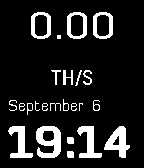
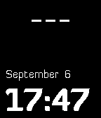

<!-- Generated by scripts/update_app_directory.py: do not edit by hand -->
[← All Pebble Developers](../developers.md)

# Alice Grey

*2 watchfaces · Last updated 2026-10-11 · [About these lists](../about-app-lists.md)*

Links: [Pebble App Store](https://apps.repebble.com/apps/dev/alice-grey_55dd18ce807bb33623000044) · [GitHub (AliceGrey)](https://github.com/AliceGrey) · [Website (alicegrey.github.io)](http://alicegrey.github.io)

<button type="button" data-filter="all" aria-pressed="true">All 2</button><button type="button" data-filter="watchface" aria-pressed="false">Watchfaces 2</button><button type="button" data-filter="watchapp" aria-pressed="false" disabled>Apps 0</button>

<label class="dev-sort">Sort by <select><option value="updated">Recently updated</option><option value="released">Newest release</option><option value="title">A–Z</option></select></label>

<h2 class="app-name" id="app-55ecf2804fcd1c2851000061"><a href="https://apps.repebble.com/55ecf2804fcd1c2851000061">SlushPoolWatcher</a> v0.1</h2>
<a class="app-source" href="https://github.com/AliceGrey/SlushPoolWatcherPebble" title="Source code" data-search-exclude>View source</a>

Watchface

No licence Released 2015-09-07 Updated 2015-09-07

Runs on: Time 2, Pebble 2 Duo, Pebble 2, Time, Classic

A watchface to monitor your miners on the Slush pool / Bitcoincz

<h2 class="app-name" id="app-55ecd9c28c537c1a5b00006f"><a href="https://apps.repebble.com/55ecd9c28c537c1a5b00006f">CkPoolWatcher</a> v0.2</h2>
<a class="app-source" href="https://github.com/AliceGrey/CKPoolWatcherPebble" title="Source code" data-search-exclude>View source</a>

Watchface

No licence Released 2015-09-07 Updated 2015-09-07

Runs on: Time 2, Pebble 2 Duo, Pebble 2, Time, Classic

A watchface to monitor your miners on CKPool Kano.is.

