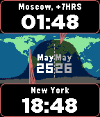

<!-- Generated by scripts/update_app_directory.py: do not edit by hand -->
[← All Pebble Developers](../developers.md)

# aliner

*1 watchface · Last updated 2026-10-11 · [About these lists](../about-app-lists.md)*

Links: [Rebble App Store](https://apps.rebble.io/en_US/developer/53613500f4ef7896ed00012e/1) · [GitHub (alin256)](https://github.com/alin256)

<h2 class="app-name" id="app-58fb80db6ca387c7c2001fb5"><a href="https://apps.rebble.io/en_US/application/58fb80db6ca387c7c2001fb5">Multi-zone Earth</a> v1.1</h2>
<a class="app-source" href="https://github.com/alin256/pebble-multi-zone" title="Source code" data-search-exclude>View source</a>

Watchface

GPL-3.0 Released 2017-04-22 Updated 2017-05-26 Rebble App Store

Runs on: Time 2, Time

This watchface is perfect while travelling. It allows to keep any 2 time-zones visible while showing their position on the world map and the offset from current location. Yes, the time in the…

