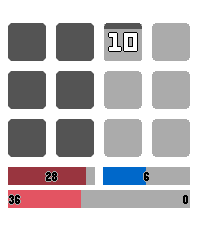

<!-- Generated by scripts/update_app_directory.py: do not edit by hand -->
[← All Pebble Developers](../developers.md)

# Alkali-V2

*1 watchface · Last updated 2026-10-12 · [About these lists](../about-app-lists.md)*

Links: [Pebble App Store](https://apps.repebble.com/apps/dev/alkali-v2_859c25ea8dbd5d52047449c0) · [GitHub (Alkali-V2)](https://github.com/Alkali-V2)

<h2 class="app-name" id="app-751e82f074064ce5b5fb0c58"><a href="https://apps.repebble.com/751e82f074064ce5b5fb0c58">VITA</a> v1.0.2</h2>
<a class="app-source" href="https://github.com/Alkali-V2/Pebble-Vita" title="Source code" data-search-exclude>View source</a>

Watchface

No licence Released 2026-06-29 Updated 2026-07-04

Runs on: Time 2, Pebble 2 Duo, Pebble 2, Time, Classic

Inspired by Pnooka and tens, this watch face keeps the simplicity of a 12-hour watch face while allowing the user to switch on text for important fields like minutes past the hours, current date…

