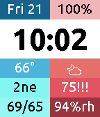

<!-- Generated by scripts/update_app_directory.py: do not edit by hand -->
[← All Pebble Developers](../developers.md)

# Allan MacLeod

*1 watchface · Last updated 2026-10-12 · [About these lists](../about-app-lists.md)*

Links: [Pebble App Store](https://apps.repebble.com/apps/dev/allan-macleod_572e4fcf2ddb7cd2dc000001) · [GitHub (aemacleod)](https://github.com/aemacleod)

<h2 class="app-name" id="app-579914491482cd5d4b0000de"><a href="https://apps.repebble.com/579914491482cd5d4b0000de">Eight-frame</a> v1.6</h2>
<a class="app-source" href="https://github.com/aemacleod/eight-frame" title="Source code" data-search-exclude>View source</a>

Watchface

MIT Released 2016-07-27 Updated 2016-10-17

Runs on: Round 2, Time 2, Pebble 2 Duo, Pebble 2, Time Round, Time, Classic

v1.6 Adds support for Pebble 2, updates how complications display on Pebble Time Round watches, fixes several bugs, and makes some improvements to save battery life. Eight-frame is a watchface…

