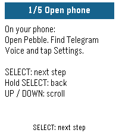

<!-- Generated by scripts/update_app_directory.py: do not edit by hand -->
[← All Pebble Developers](../developers.md)

# altarr

*1 app · Last updated 2026-10-12 · [About these lists](../about-app-lists.md)*

Links: [Pebble App Store](https://apps.repebble.com/apps/dev/altarr_a3b9b59377bfff3d652e6a00) · [GitHub (altarr)](https://github.com/altarr)

<h2 class="app-name" id="app-64c41a2069e54ac7a980478c"><a href="https://apps.repebble.com/64c41a2069e54ac7a980478c">Telegram Voice</a> v1.0.1</h2>
<a class="app-source" href="https://github.com/altarr/pebble-telegram-voice" title="Source code" data-search-exclude>View source</a>

App

No licence Released 2026-09-13 Updated 2026-09-13

Runs on: Round 2, Time 2, Pebble 2 Duo, Pebble 2, Time Round, Time

Use your Pebble watch to speak to your Telegram bot. Press SELECT, say what&#x27;s on your mind, and read your bot&#x27;s reply on your wrist. Connect your own compatible AI assistant or automation bot for…

