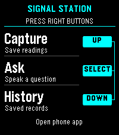
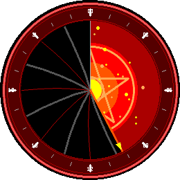
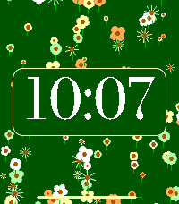

<!-- Generated by scripts/update_app_directory.py: do not edit by hand -->
[← All Pebble Developers](../developers.md)

# Ambient Time

*5 watchfaces and 1 app · Last updated 2026-10-12 · [About these lists](../about-app-lists.md)*

Links: [Pebble App Store](https://apps.repebble.com/apps/dev/ambient-time_3a9986a63073f9f293be7e14) · [GitHub (lukeslp)](https://github.com/lukeslp) · [Website (dr.eamer.dev)](https://dr.eamer.dev/downloads/apps/signal-station/)

<button type="button" data-filter="all" aria-pressed="true">All 6</button><button type="button" data-filter="watchface" aria-pressed="false">Watchfaces 5</button><button type="button" data-filter="watchapp" aria-pressed="false">Apps 1</button>

<label class="dev-sort">Sort by <select><option value="updated">Recently updated</option><option value="released">Newest release</option><option value="title">A–Z</option></select></label>

<h2 class="app-name" id="app-37360ca4d9764881bd1d6f4d"><a href="https://apps.repebble.com/37360ca4d9764881bd1d6f4d">Signal Station</a> v1.8.1</h2>
<a class="app-source" href="https://dr.eamer.dev/downloads/apps/signal-station/#source" title="Source code" data-search-exclude>View source</a>

App

Released 2026-09-09 Updated 2026-10-05

Runs on: Round 2, Time 2, Pebble 2 Duo, Pebble 2, Time Round, Time

EXPERMENTAL This is a signal / presence awareness system with a Pebble face serving as interface and capture tool. It also offers chat from your wrist with the language model you choose, enriched…

<h2 class="app-name" id="app-ec086ce0bfe44c8abc0fed57"><a href="https://apps.repebble.com/ec086ce0bfe44c8abc0fed57">Nearly Time</a> v1.5.1</h2>
<a class="app-source" href="https://github.com/lukeslp/pebble-anti-grid" title="Source code" data-search-exclude>View source</a>

Watchface

Released 2026-08-21 Updated 2026-10-05

Runs on: Round 2, Time 2, Pebble 2 Duo, Pebble 2, Time Round, Time

The hands are correct, the markers are sloppy. It&#x27;s irritating! And configurable. Configurably irritating! lukesteuber.com

<h2 class="app-name" id="app-ecd9036b7d7d465fb9c6c701"><a href="https://apps.repebble.com/ecd9036b7d7d465fb9c6c701">Doom Iris</a> v1.5.3</h2>
<a class="app-source" href="https://github.com/lukeslp/pebble-doom-iris" title="Source code" data-search-exclude>View source</a>

Watchface

Released 2026-08-21 Updated 2026-10-05

Runs on: Round 2, Time Round

A DOOM IRIS that opens over 24 hours, with which to INTIMIDATE YOUR ENEMIES

<h2 class="app-name" id="app-2be0eb38718d40fe892053f0"><a href="https://apps.repebble.com/2be0eb38718d40fe892053f0">Spoken</a> v1.6.3</h2>
<a class="app-source" href="https://github.com/lukeslp/pebble-spoken" title="Source code" data-search-exclude>View source</a>

Watchface

Released 2026-08-21 Updated 2026-09-04

Runs on: Round 2, Time 2, Pebble 2 Duo, Pebble 2, Time Round, Time

Time as you&#x27;d say it (in one dialect of English).

<h2 class="app-name" id="app-c3973155098047dfb77eed7d"><a href="https://apps.repebble.com/c3973155098047dfb77eed7d">Sweep</a> v1.5.1</h2>
<a class="app-source" href="https://github.com/lukeslp/pebble-sweep" title="Source code" data-search-exclude>View source</a>

Watchface

Released 2026-08-21 Updated 2026-09-03

Runs on: Round 2, Time 2, Pebble 2 Duo, Pebble 2, Time Round, Time

An seconds hand that sweeps the dial changing the colors of MM:DD with big primary bold ones.

<h2 class="app-name" id="app-0b25bf6379bd4e7195381b4a"><a href="https://apps.repebble.com/0b25bf6379bd4e7195381b4a">Bloom</a> v1.0.2</h2>
<a class="app-source" href="https://github.com/lukeslp/pebble-bloom-digits" title="Source code" data-search-exclude>View source</a>

Watchface

Released 2026-09-03 Updated 2026-09-03

Runs on: Time 2, Pebble 2 Duo, Pebble 2, Time

A new garden every minute. Varied flowers emerge from the center, grow outward every second, and reach the corners as the minute ends. Petal shapes, counts, scales, stems, arrangements, and color…

