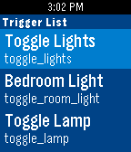

<!-- Generated by scripts/update_app_directory.py: do not edit by hand -->
[← All Pebble Developers](../developers.md)

# amcolash

*1 app · Last updated 2026-10-12 · [About these lists](../about-app-lists.md)*

Links: [Pebble App Store](https://apps.repebble.com/apps/dev/amcolash_535552f41b0c43bce500007f) · [GitHub (amcolash)](https://github.com/amcolash)

<h2 class="app-name" id="app-568f550d05f633c62800003d"><a href="https://apps.repebble.com/568f550d05f633c62800003d">IoT Buddy</a> v2.2</h2>
<a class="app-source" href="https://github.com/amcolash/PebbleIoT" title="Source code" data-search-exclude>View source</a>

App

MIT Released 2016-01-08 Updated 2016-10-28

Runs on: Round 2, Time 2, Pebble 2 Duo, Pebble 2, Time Round, Time, Classic

IoT Buddy is an app to send commands to the Maker channel of IFTTT. Currently is supports sending a simple POST to the channel. You can add as many event triggers as you want to the list and can…

