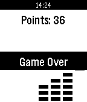

<!-- Generated by scripts/update_app_directory.py: do not edit by hand -->
[← All Pebble Developers](../developers.md)

# ameiga

*1 app · Last updated 2026-10-11 · [About these lists](../about-app-lists.md)*

Links: [Pebble App Store](https://apps.repebble.com/apps/dev/ameiga_52b5dd8dd2b97a7abc000021) · [GitHub (YagoCarballo)](https://github.com/YagoCarballo) · [Website (ameiga.com)](http://ameiga.com/)

<h2 class="app-name" id="app-52b61a69f9d7a3652d000006"><a href="https://apps.repebble.com/52b61a69f9d7a3652d000006">The Stacker</a> v1.2</h2>
<a class="app-source" href="https://github.com/YagoCarballo/pebble_stacker" title="Source code" data-search-exclude>View source</a>

App

GPL-3.0 Released 2013-12-21 Updated 2015-05-27

Runs on: Time 2, Pebble 2 Duo, Pebble 2, Time, Classic

The classic stacker game now on your wrist, ideal to play in those spare minutes when you have to wait for something.

