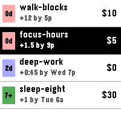

<!-- Generated by scripts/update_app_directory.py: do not edit by hand -->
[← All Pebble Developers](../developers.md)

# Amolith

*1 app · Last updated 2026-10-11 · [About these lists](../about-app-lists.md)*

Links: [Pebble App Store](https://apps.repebble.com/apps/dev/amolith_765459e0318e61f6f01a5b2a)

<h2 class="app-name" id="app-f1152802609442c08cb60daf"><a href="https://apps.repebble.com/f1152802609442c08cb60daf">Beehave</a> v0.1.0</h2>
<a class="app-source" href="https://tangled.org/secluded.site/beehave" title="Source code" data-search-exclude>View source</a>

App

Released 2026-08-14 Updated 2026-08-14

Runs on: Time 2

Beehave is an unofficial Beeminder client for Pebble Time 2. It lists goals in Beeminder urgency order. Open a goal to see its safety buffer, requirement, deadline, and pledge. For manual goals…

