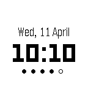

<!-- Generated by scripts/update_app_directory.py: do not edit by hand -->
[← All Pebble Developers](../developers.md)

# Amos Tan

*1 watchface · Last updated 2026-10-12 · [About these lists](../about-app-lists.md)*

Links: [Rebble App Store](https://apps.rebble.io/en_US/developer/53b9647c36ce4c0f500001bc/1) · [GitHub (AlphaTRL)](https://github.com/AlphaTRL)

<h2 class="app-name" id="app-56827ebce08e48f8ed0000c6"><a href="https://apps.rebble.io/en_US/application/56827ebce08e48f8ed0000c6">Minimal</a> v1.4</h2>
<a class="app-source" href="https://github.com/AlphaTRL/pebble-watchface-minimal" title="Source code" data-search-exclude>View source</a>

Watchface

MIT Released 2015-12-29 Updated 2016-11-07 Rebble App Store

Runs on: Round 2, Time 2, Pebble 2 Duo, Pebble 2, Time Round, Time, Classic

A minimal watch face design. Shows you the date, time and battery. Leave a ❤️ if you like the watch face &lt;3

