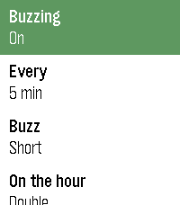

<!-- Generated by scripts/update_app_directory.py: do not edit by hand -->
[← All Pebble Developers](../developers.md)

# Amxelemara

*1 app · Last updated 2026-11-23 · [About these lists](../about-app-lists.md)*

Links: [Pebble App Store](https://apps.repebble.com/apps/dev/amxelemara_1f0dfd362d1ab99f64428473) · [GitHub (amxelemara)](https://github.com/amxelemara)

<h2 class="app-name" id="app-127494506276466b95246f4e"><a href="https://apps.repebble.com/127494506276466b95246f4e">Time Sense</a> v1.0.0</h2>
<a class="app-source" href="https://github.com/amxelemara/time_sense" title="Source code" data-search-exclude>View source</a>

App

MIT Released 2026-11-17 Updated 2026-11-17

Runs on: Time 2

Time Sense is a tool to help time blind people feel the passage of time. It vibrates every 5 minutes on the hour (not from when it is turned on). - Interval is adjustable in settings - Can set a…

