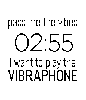

<!-- Generated by scripts/update_app_directory.py: do not edit by hand -->
[← All Pebble Developers](../developers.md)

# amyjchen

*1 watchface · Last updated 2026-10-11 · [About these lists](../about-app-lists.md)*

Links: [Pebble App Store](https://apps.repebble.com/apps/dev/amyjchen_540a0685950b21cb26000230) · [GitHub (amyjchen)](https://github.com/amyjchen) · [Website (amyjchen.github.io)](http://amyjchen.github.io/vibes)

<h2 class="app-name" id="app-57134355a6ae41b29b000007"><a href="https://apps.repebble.com/57134355a6ae41b29b000007">VIBES</a> v1.0</h2>
<a class="app-source" href="https://github.com/amyjchen/vibes" title="Source code" data-search-exclude>View source</a>

Watchface

No licence Released 2016-04-17 Updated 2016-04-17

Runs on: Round 2, Time 2, Pebble 2 Duo, Pebble 2, Time Round, Time, Classic

The minutes are expressed with four vibrations, three of short and one long. The placement of the long vibration signals the minutes. The minutes are followed by a long pause and then vibrations…

