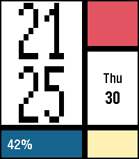
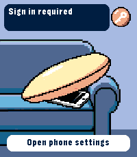
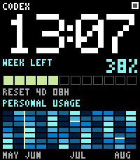

<!-- Generated by scripts/update_app_directory.py: do not edit by hand -->
[← All Pebble Developers](../developers.md)

# Analog Tick-Tocker

*4 watchfaces and 1 app · Last updated 2026-10-12 · [About these lists](../about-app-lists.md)*

Links: [Pebble App Store](https://apps.repebble.com/apps/dev/analog-tick-tocker_eb6b6dc4dbd64c7c7ea32a94) · [GitHub (meded90)](https://github.com/meded90) · [Website (instagram.com)](https://www.instagram.com/tekilla_art)

<button type="button" data-filter="all" aria-pressed="true">All 5</button><button type="button" data-filter="watchface" aria-pressed="false">Watchfaces 4</button><button type="button" data-filter="watchapp" aria-pressed="false">Apps 1</button>

<label class="dev-sort">Sort by <select><option value="updated">Recently updated</option><option value="released">Newest release</option><option value="title">A–Z</option></select></label>

<h2 class="app-name" id="app-d2ccde5d2187490085b44f8e"><a href="https://apps.repebble.com/d2ccde5d2187490085b44f8e">Mosaic Grid</a> v1.3.0</h2>
<a class="app-source" href="https://github.com/meded90/pebble-time-2-pixel-faces" title="Source code" data-search-exclude>View source</a>

Watchface

Released 2026-07-30 Updated 2026-09-09

Runs on: Time 2

Mosaic Grid turns the Pebble Time 2 display into a compact modernist poster. A smooth launch animation builds the grid from a red canvas: the time panel slides in from the left, then the lower…

<h2 class="app-name" id="app-7ffae9b84d714b9882f7a40f"><a href="https://apps.repebble.com/7ffae9b84d714b9882f7a40f">Find My iPhone</a> v0.1.4</h2>
<a class="app-source" href="https://github.com/meded90/pebble-time-2-pixel-faces/tree/main/find-my-iphone" title="Source code" data-search-exclude>View source</a>

App

Released 2026-09-01 Updated 2026-09-01

Runs on: Time 2

Ring your iPhone directly from Pebble Time 2. Open the watch app, select an iPhone with the Up and Down buttons, then hold Select for 650 ms to send the sound command. The app runs through Pebble…

<h2 class="app-name" id="app-27f48d86803e471a83b93dfe"><a href="https://apps.repebble.com/27f48d86803e471a83b93dfe">Codex Weekly</a> v1.0.11</h2>
<a class="app-source" href="https://github.com/meded90/pebble-time-2-pixel-faces" title="Source code" data-search-exclude>View source</a>

Watchface

Released 2026-08-03 Updated 2026-09-01

Runs on: Time 2

Codex Weekly places an oversized pixel clock above your remaining weekly Codex quota, reset countdown, and a GitHub-style 12-week personal usage heatmap. Data syncs through a private local bridge…

<h2 class="app-name" id="app-a1c61f1227144535accbf53c"><a href="https://apps.repebble.com/a1c61f1227144535accbf53c">Zodiac: Gemini</a> v1.4.0</h2>
<a class="app-source" href="https://github.com/meded90/pebble-time-2-pixel-faces/tree/main/zodiac-gemini" title="Source code" data-search-exclude>View source</a>

Watchface

Released 2026-08-11 Updated 2026-08-24

Runs on: Time 2

Zodiac: Gemini pairs a vivid twin portrait with large, rounded black numerals designed for the 200×228 Pebble Time 2 display. Hours and minutes are stacked in the upper-left corner without a frame…

<h2 class="app-name" id="app-d9b87c9f10a74d718db82b06"><a href="https://apps.repebble.com/d9b87c9f10a74d718db82b06">Flip Board</a> v1.2.1</h2>
<a class="app-source" href="https://github.com/meded90/pebble-time-2-pixel-faces/tree/main/flip-board" title="Source code" data-search-exclude>View source</a>

Watchface

Released 2026-07-30 Updated 2026-08-04

Runs on: Time 2

A mechanical-style pixel flip clock with animated digits, date and battery.

