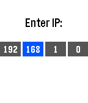

<!-- Generated by scripts/update_app_directory.py: do not edit by hand -->
[← All Pebble Developers](../developers.md)

# andars

*1 app · Last updated 2026-10-12 · [About these lists](../about-app-lists.md)*

Links: [Pebble App Store](https://apps.repebble.com/apps/dev/andars_52f077a9a0cb6a3454001a9e) · [GitHub (andars)](https://github.com/andars)

<h2 class="app-name" id="app-556a32990bfdada493000060"><a href="https://apps.repebble.com/556a32990bfdada493000060">Pebble Controller</a> v0.2</h2>
<a class="app-source" href="https://github.com/andars/pebble-controller" title="Source code" data-search-exclude>View source</a>

App

MIT Released 2015-05-30 Updated 2015-06-02

Runs on: Time 2, Pebble 2 Duo, Pebble 2, Time, Classic

This watch app allows you to transmit button presses from your Pebble to a computer and perform actions there. See the github page at https://github.com/andars/pebble-controller (linked below) for…

