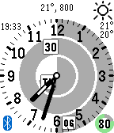

<!-- Generated by scripts/update_app_directory.py: do not edit by hand -->
[← All Pebble Developers](../developers.md)

# AndCycle

*1 watchface · Last updated 2026-10-12 · [About these lists](../about-app-lists.md)*

Links: [Pebble App Store](https://apps.repebble.com/apps/dev/andcycle_5612259599362ae2e300007c) · [GitHub (AndCycle)](https://github.com/AndCycle)

<h2 class="app-name" id="app-56446283199c1f6ca1000033"><a href="https://apps.repebble.com/56446283199c1f6ca1000033">time 4391</a> v1.2</h2>
<a class="app-source" href="https://github.com/AndCycle/PebbleFaceTryout" title="Source code" data-search-exclude>View source</a>

Watchface

No licence Released 2015-11-12 Updated 2016-06-30

Runs on: Time 2, Time

I just write the watchface that I want, this is a work in progress, hope I will have time to finish this. Todo: configuration able to change appid for OpenWeatherMap C/F setting what should I put…

