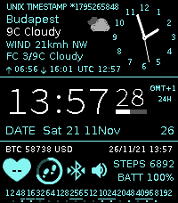
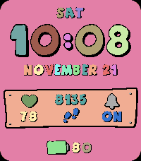
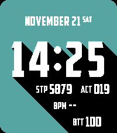

<!-- Generated by scripts/update_app_directory.py: do not edit by hand -->
[← All Pebble Developers](../developers.md)

# Andor Czafik

*3 watchfaces · Last updated 2026-11-23 · [About these lists](../about-app-lists.md)*

Links: [Pebble App Store](https://apps.repebble.com/apps/dev/andor-czafik_56dc8ce0c74e8e218b00001f) · [GitHub (czandor)](https://github.com/czandor) · [Website (czandor.hu)](https://czandor.hu/paypal/prog)

<button type="button" data-filter="all" aria-pressed="true">All 3</button><button type="button" data-filter="watchface" aria-pressed="false">Watchfaces 3</button><button type="button" data-filter="watchapp" aria-pressed="false" disabled>Apps 0</button>

<label class="dev-sort">Sort by <select><option value="updated">Recently updated</option><option value="released">Newest release</option><option value="title">A–Z</option></select></label>

<h2 class="app-name" id="app-4bb1f8cbeada4d7c8da548e2"><a href="https://apps.repebble.com/4bb1f8cbeada4d7c8da548e2">Programmer&#x27;s Watch</a> v1.6.0</h2>
<a class="app-source" href="https://github.com/czandor/programmersWatchPebble" title="Source code" data-search-exclude>View source</a>

Watchface

No licence Released 2026-11-21 Updated 2026-11-21

Runs on: Time 2

Programmer&#x27;s Watch is a data-dense, native C watchface for Pebble Time 2 (Emery), faithfully ported from the original Fitbit watchface. Features: 🕒 Dual clock: Large digital time (12h/24h…

<h2 class="app-name" id="app-d7dbd0a0e94f4bee9e7582f4"><a href="https://apps.repebble.com/d7dbd0a0e94f4bee9e7582f4">Kiddo</a> v1.0.1</h2>
<a class="app-source" href="https://github.com/czandor/Kiddo-Clockface-Pebble" title="Source code" data-search-exclude>View source</a>

Watchface

No licence Released 2026-11-21 Updated 2026-11-21

Runs on: Round 2, Time 2, Time Round, Time

Kiddo brings the playful Fitbit Kiddo watchface (Design and Code: Andor Czafik) natively to Pebble Time, Pebble Time Round, Pebble Time 2 and Pebble Round 2. 🖍️ Cartoon Rainbow Letters: The…

<h2 class="app-name" id="app-8d6365bf7c3747a08fe12044"><a href="https://apps.repebble.com/8d6365bf7c3747a08fe12044">Blokk</a> v1.1.1</h2>
<a class="app-source" href="https://github.com/czandor/Blokk-Clockface-Pebble" title="Source code" data-search-exclude>View source</a>

Watchface

No licence Released 2026-11-21 Updated 2026-11-21

Runs on: Round 2, Time 2, Time Round, Time

🕒 Bold Typography &amp; 45° Long Shadows: Crisp American Captain digits, a centered circular colon, a date header (MONTH DD WDAY), and an optional bottom-left AM/PM indicator in 12-hour mode. 🎨 9…

