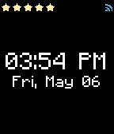

<!-- Generated by scripts/update_app_directory.py: do not edit by hand -->
[← All Pebble Developers](../developers.md)

# André Bonhôte

*1 watchface · Last updated 2026-10-12 · [About these lists](../about-app-lists.md)*

Links: [Pebble App Store](https://apps.repebble.com/apps/dev/andr-bonh-te_52dcd16bf6af49dd3d00000c) · [GitHub (abonhote)](https://github.com/abonhote)

<h2 class="app-name" id="app-5721b9b159439e6020000022"><a href="https://apps.repebble.com/5721b9b159439e6020000022">Retro-Time C</a> v1.3</h2>
<a class="app-source" href="https://github.com/abonhote/Retro-Time" title="Source code" data-search-exclude>View source</a>

Watchface

Other Released 2016-04-28 Updated 2016-05-06

Runs on: Time 2, Pebble 2 Duo, Pebble 2, Time, Classic

Watchface based on Jon George&#x27;s Retro Time. Basically the same, just with some color ;)

