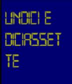
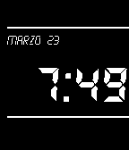

<!-- Generated by scripts/update_app_directory.py: do not edit by hand -->
[← All Pebble Developers](../developers.md)

# Andrea Ottaviani

*3 watchfaces · Last updated 2026-10-12 · [About these lists](../about-app-lists.md)*

Links: [Pebble App Store](https://apps.repebble.com/apps/dev/andrea-ottaviani_54f6bfc5feb37e1bc000001c) · [GitHub (aotta)](https://github.com/aotta)

<button type="button" data-filter="all" aria-pressed="true">All 3</button><button type="button" data-filter="watchface" aria-pressed="false">Watchfaces 3</button><button type="button" data-filter="watchapp" aria-pressed="false" disabled>Apps 0</button>

<label class="dev-sort">Sort by <select><option value="updated">Recently updated</option><option value="released">Newest release</option><option value="title">A–Z</option></select></label>

<h2 class="app-name" id="app-55fbf4e81add711f13000069"><a href="https://apps.repebble.com/55fbf4e81add711f13000069">SnoopyTime</a> v1.7</h2>
<a class="app-source" href="https://github.com/aotta/Snoopy" title="Source code" data-search-exclude>View source</a>

Watchface

No licence Released 2015-09-18 Updated 2026-04-04

Runs on: Round 2, Time 2, Time Round, Time

Snoopy time facewatch... nothing more!

<h2 class="app-name" id="app-560d0013cda63289ce000061"><a href="https://apps.repebble.com/560d0013cda63289ce000061">TESTOCOL</a> v1.1</h2>
<a class="app-source" href="http://github.com/aotta/TestoCol" title="Source code" data-search-exclude>View source</a>

Watchface

No licence Released 2015-10-01 Updated 2015-10-01

Runs on: Time 2, Time

Orologio testuale a colori, in italiano Italian text only!

<h2 class="app-name" id="app-551086ca5c415cf80700002c"><a href="https://apps.repebble.com/551086ca5c415cf80700002c">OldLedStyle</a> v0.3</h2>
<a class="app-source" href="https://github.com/aotta/OLDLED" title="Source code" data-search-exclude>View source</a>

Watchface

No licence Released 2015-03-23 Updated 2015-03-27

Runs on: Time 2, Pebble 2 Duo, Pebble 2, Time, Classic

A simple old led watch 80&#x27;s style

