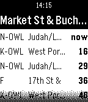

<!-- Generated by scripts/update_app_directory.py: do not edit by hand -->
[← All Pebble Developers](../developers.md)

# Andreas Bauer

*1 app · Last updated 2026-10-12 · [About these lists](../about-app-lists.md)*

Links: [Pebble App Store](https://apps.repebble.com/apps/dev/andreas-bauer_52badafbaac0624125000087)

<h2 class="app-name" id="app-52e94daddcc23ca56000006d"><a href="https://apps.repebble.com/52e94daddcc23ca56000006d">Departure Monitor</a> v1.2</h2>
<a class="app-source" href="https://bitbucket.org/abauer/pebble-departure" title="Source code" data-search-exclude>View source</a>

App

Released 2014-01-29 Updated 2016-01-12

Runs on: Time 2, Pebble 2 Duo, Pebble 2, Time, Classic

The app shows the departure time of buses, trams and trains at nearby stations. Many public transportation networks around the world are supported, for example: San Francisco, London, many in…

