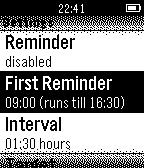
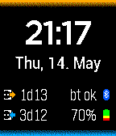
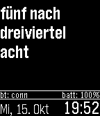

<!-- Generated by scripts/update_app_directory.py: do not edit by hand -->
[← All Pebble Developers](../developers.md)

# Andreas Neustifter

*2 watchfaces and 1 app · Last updated 2026-10-12 · [About these lists](../about-app-lists.md)*

Links: [Pebble App Store](https://apps.repebble.com/apps/dev/andreas-neustifter_5304d9e3fe93ed25bf000249) · [GitHub (astifter)](https://github.com/astifter) · [Website (astifter.github.io)](http://astifter.github.io/Drink)

<button type="button" data-filter="all" aria-pressed="true">All 3</button><button type="button" data-filter="watchface" aria-pressed="false">Watchfaces 2</button><button type="button" data-filter="watchapp" aria-pressed="false">Apps 1</button>

<label class="dev-sort">Sort by <select><option value="updated">Recently updated</option><option value="released">Newest release</option><option value="title">A–Z</option></select></label>

<h2 class="app-name" id="app-553ea4d8602d4220260000d7"><a href="https://apps.repebble.com/553ea4d8602d4220260000d7">Drink!</a> v1.1</h2>
<a class="app-source" href="https://github.com/astifter/Drink" title="Source code" data-search-exclude>View source</a>

App

No licence Released 2015-04-27 Updated 2015-06-15

Runs on: Time 2, Pebble 2 Duo, Pebble 2, Time, Classic

NEW: The optional companion app can fetch logged data from the watch to your Android smartphone! Stay hydrated! Reminds you to drink during the day, includes reminders, vibration, snoozing and…

<h2 class="app-name" id="app-5554f3a8f5c8abb110000016"><a href="https://apps.repebble.com/5554f3a8f5c8abb110000016">BetteryWatch</a> v1.1</h2>
<a class="app-source" href="https://github.com/astifter/BetteryWatch" title="Source code" data-search-exclude>View source</a>

Watchface

No licence Released 2015-05-14 Updated 2015-06-09

Runs on: Time 2, Pebble 2 Duo, Pebble 2, Time, Classic

A watchface with a better battery estimate. This watchface shows (beside the Bluetooth state and the battery percentage) the time since last fully charged and the estimated running time with the…

<h2 class="app-name" id="app-543eb5b1ffbc4e01d400001d"><a href="https://apps.repebble.com/543eb5b1ffbc4e01d400001d">CircaText</a> v1.3</h2>
<a class="app-source" href="https://github.com/astifter/CircaText" title="Source code" data-search-exclude>View source</a>

Watchface

No licence Released 2014-10-15 Updated 2015-01-22

Runs on: Time 2, Pebble 2 Duo, Pebble 2, Time, Classic

Ein österreichisches Pebble-Watchface das die ungefähre Zeit in natürlicher Sprache anzeigt. Derzeit sind 2 Varianten des Texts verfügbar. (Und zusätzlich Tag, Wochentag, Monat, Bluetooth-Status…

