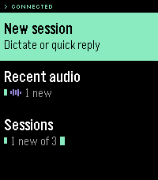
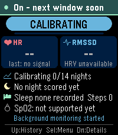
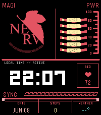
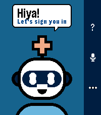

<!-- Generated by scripts/update_app_directory.py: do not edit by hand -->
[← All Pebble Developers](../developers.md)

# Andreas Varotsis

*1 watchface and 3 apps · Last updated 2026-10-26 · [About these lists](../about-app-lists.md)*

Links: [Pebble App Store](https://apps.repebble.com/apps/dev/andreas-varotsis_021ad35e7c7a1d61ceaac484) · [GitHub (AndreasThinks)](https://github.com/AndreasThinks) · [Website (andreasthinks.github.io)](https://andreasthinks.github.io/pebble-sentinel-docs/)

<button type="button" data-filter="all" aria-pressed="true">All 4</button><button type="button" data-filter="watchface" aria-pressed="false">Watchfaces 1</button><button type="button" data-filter="watchapp" aria-pressed="false">Apps 3</button>

<label class="dev-sort">Sort by <select><option value="updated">Recently updated</option><option value="released">Newest release</option><option value="title">A–Z</option></select></label>

<h2 class="app-name" id="app-22984baa50dd4b68ba9a0945"><a href="https://apps.repebble.com/22984baa50dd4b68ba9a0945">Wristbound</a> v0.6.0</h2>
<a class="app-source" href="https://github.com/AndreasThinks/hermes-wristbound" title="Source code" data-search-exclude>View source</a>

App

No licence Released 2026-10-22 Updated 2026-10-23

Runs on: Round 2, Time 2, Pebble 2 Duo, Pebble 2, Time Round, Time, Classic

Hermes on your wrist. Browse conversations, catch audio replies, dictate or send a quick reply, and choose where to listen: phone headphones, phone speaker, or a supported watch speaker. Includes…

<h2 class="app-name" id="app-fe6550c8c87c49cbbc9d8cba"><a href="https://apps.repebble.com/fe6550c8c87c49cbbc9d8cba">Sentinel</a> v0.1.1</h2>
<a class="app-source" href="https://github.com/AndreasThinks/pebble-sentinel" title="Source code" data-search-exclude>View source</a>

App

No licence Released 2026-10-18 Updated 2026-10-18

Runs on: Time 2

Sentinel is an experimental, on-watch wellness monitor for Pebble Time 2. Enable background monitoring once, then keep using your normal watchface. Sentinel attempts short overnight heart-rate and…

<h2 class="app-name" id="app-83a45005b95f438590f63b26"><a href="https://apps.repebble.com/83a45005b95f438590f63b26">Terminal Dogma</a> v1.0.21</h2>
<a class="app-source" href="https://github.com/AndreasThinks/terminal-dogma" title="Source code" data-search-exclude>View source</a>

Watchface

No licence Released 2026-06-06 Updated 2026-10-17

Runs on: Time 2

Terminal Dogma is a NERV-inspired Pebble Time 2 (Emery) watchface with a MAGI-style HUD and live battery, phone-link, health, steps and weather status. Shake to open a three-hour heart-rate graph…

<h2 class="app-name" id="app-dd12fd7290054f6aaaa4e41f"><a href="https://apps.repebble.com/dd12fd7290054f6aaaa4e41f">Squire Plus</a> v0.1.1</h2>
<a class="app-source" href="https://github.com/AndreasThinks/pebble-squire" title="Source code" data-search-exclude>View source</a>

App

Apache-2.0 Released 2026-10-10 Updated 2026-10-10

Runs on: Round 2, Time 2, Pebble 2 Duo, Pebble 2, Time Round, Time

Squire Plus puts your own AI agent on your Pebble. Press SELECT, ask a question out loud, and your agent&#x27;s answer appears on your watch. It connects to an agent you already run, such as Hermes or…

