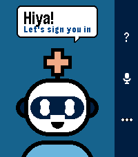

<!-- Generated by scripts/update_app_directory.py: do not edit by hand -->
[← All Pebble Developers](../developers.md)

# Andreas Varotsis

*1 watchface and 1 app · Last updated 2026-10-12 · [About these lists](../about-app-lists.md)*

Links: [Pebble App Store](https://apps.repebble.com/apps/dev/andreas-varotsis_021ad35e7c7a1d61ceaac484) · [GitHub (AndreasThinks)](https://github.com/AndreasThinks)

<button type="button" data-filter="all" aria-pressed="true">All 2</button><button type="button" data-filter="watchface" aria-pressed="false">Watchfaces 1</button><button type="button" data-filter="watchapp" aria-pressed="false">Apps 1</button>

<label class="dev-sort">Sort by <select><option value="updated">Recently updated</option><option value="released">Newest release</option><option value="title">A–Z</option></select></label>

<h2 class="app-name" id="app-dd12fd7290054f6aaaa4e41f"><a href="https://apps.repebble.com/dd12fd7290054f6aaaa4e41f">Squire Plus</a> v0.1.1</h2>
<a class="app-source" href="https://github.com/AndreasThinks/pebble-squire" title="Source code" data-search-exclude>View source</a>

App

Apache-2.0 Released 2026-10-10 Updated 2026-10-10

Runs on: Round 2, Time 2, Pebble 2 Duo, Pebble 2, Time Round, Time

Squire Plus puts your own AI agent on your Pebble. Press SELECT, ask a question out loud, and your agent&#x27;s answer appears on your watch. It connects to an agent you already run, such as Hermes or…

<h2 class="app-name" id="app-83a45005b95f438590f63b26"><a href="https://apps.repebble.com/83a45005b95f438590f63b26">Terminal Dogma</a> v1.0.16</h2>
<a class="app-source" href="https://github.com/AndreasThinks/pebble-watchface" title="Source code" data-search-exclude>View source</a>

Watchface

No licence Released 2026-06-06 Updated 2026-06-08

Runs on: Time 2

A tactical terminal-inspired Pebble Time 2 watchface with configurable format, datamodules, and Evangelion inspired status chevrons.

