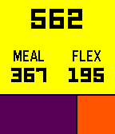

<!-- Generated by scripts/update_app_directory.py: do not edit by hand -->
[← All Pebble Developers](../developers.md)

# Andrei Ciubotariu

*1 watchface and 1 app · Last updated 2026-10-12 · [About these lists](../about-app-lists.md)*

Links: [Pebble App Store](https://apps.repebble.com/apps/dev/andrei-ciubotariu_55e1175d6cdee4329e0000af) · [GitHub (andreiciubotariu)](https://github.com/andreiciubotariu)

<button type="button" data-filter="all" aria-pressed="true">All 2</button><button type="button" data-filter="watchface" aria-pressed="false">Watchfaces 1</button><button type="button" data-filter="watchapp" aria-pressed="false">Apps 1</button>

<label class="dev-sort">Sort by <select><option value="updated">Recently updated</option><option value="released">Newest release</option><option value="title">A–Z</option></select></label>

<h2 class="app-name" id="app-56f4bd20a16b34e00c000036"><a href="https://apps.repebble.com/56f4bd20a16b34e00c000036">WatMoney</a> v1.4</h2>
<a class="app-source" href="https://github.com/andreiciubotariu/watmoney" title="Source code" data-search-exclude>View source</a>

App

MIT Released 2016-03-25 Updated 2016-09-01

Runs on: Round 2, Time 2, Pebble 2 Duo, Pebble 2, Time Round, Time, Classic

View your University of Waterloo WatCard balance from your wrist. Total at the top, broken down into meal and flex balances below. Not affiliated with the University of Waterloo.

<h2 class="app-name" id="app-573674d776951a3d05000005"><a href="https://apps.repebble.com/573674d776951a3d05000005">Band</a> v1.2</h2>
<a class="app-source" href="https://github.com/andreiciubotariu/band-watchface" title="Source code" data-search-exclude>View source</a>

Watchface

MIT Released 2016-05-14 Updated 2016-09-01

Runs on: Round 2, Time 2, Pebble 2 Duo, Pebble 2, Time Round, Time, Classic

A (really) simple watchface. Time, date, disconnect indicator, and colour options.

