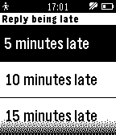
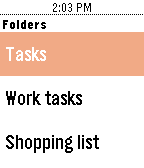

<!-- Generated by scripts/update_app_directory.py: do not edit by hand -->
[← All Pebble Developers](../developers.md)

# Andrei Markeev

*3 apps · Last updated 2026-10-12 · [About these lists](../about-app-lists.md)*

Links: [Pebble App Store](https://apps.repebble.com/apps/dev/andrei-markeev_55955a42e26351be6b000036) · [Rebble App Store](https://apps.rebble.io/en_US/developer/55955a42e26351be6b000036/1) · [GitHub (andrei-markeev)](https://github.com/andrei-markeev)

<button type="button" data-filter="all" aria-pressed="true">All 3</button><button type="button" data-filter="watchface" aria-pressed="false" disabled>Watchfaces 0</button><button type="button" data-filter="watchapp" aria-pressed="false">Apps 3</button>

<label class="dev-sort">Sort by <select><option value="updated">Recently updated</option><option value="released">Newest release</option><option value="title">A–Z</option></select></label>

<h2 class="app-name" id="app-55a0cf1181def002d7000002"><a href="https://apps.repebble.com/55a0cf1181def002d7000002">Events 365</a> v2.5</h2>
<a class="app-source" href="https://github.com/andrei-markeev/pebble-outlook-events" title="Source code" data-search-exclude>View source</a>

App

No licence Released 2015-07-11 Updated 2025-10-20

Runs on: Time 2, Pebble 2 Duo, Pebble 2, Time, Classic

The app retrieves Office 365 Outlook events and displays them as a list, which you can then browse and see details of each event. Events are cached so they can also be browsed offline (even when…

<h2 class="app-name" id="app-56e4b9c2b7a601cf7900003b"><a href="https://apps.repebble.com/56e4b9c2b7a601cf7900003b">Notes 365</a> v1.7</h2>
<a class="app-source" href="https://github.com/andrei-markeev/pebble-onenote" title="Source code" data-search-exclude>View source</a>

App

Unlicense Released 2016-03-13 Updated 2024-12-03

Runs on: Round 2, Time 2, Pebble 2 Duo, Pebble 2, Time Round, Time, Classic

Displays OneNote notebooks from Office365 or OneNote Online on Pebble. P.S. This app was NOT developed by Microsoft and is not affiliated with Microsoft. Office 365 is trademark and OneNote is…

<h2 class="app-name" id="app-59182e3e6ca3871fe8000aa2"><a href="https://apps.rebble.io/en_US/application/59182e3e6ca3871fe8000aa2">Tasks 365</a> v1.0</h2>
<a class="app-source" href="https://github.com/andrei-markeev/pebble-outlook-tasks" title="Source code" data-search-exclude>View source</a>

App

No licence Released 2017-05-14 Updated 2017-05-14 Rebble App Store

Runs on: Round 2, Time 2, Pebble 2 Duo, Pebble 2, Time Round, Time, Classic

Display tasks from MS Outlook and complete them right from the watch! Note: Project is not affiliated with Microsoft.

