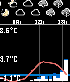
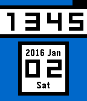

<!-- Generated by scripts/update_app_directory.py: do not edit by hand -->
[← All Pebble Developers](../developers.md)

# Andrej Krutak

*2 watchfaces and 1 app · Last updated 2026-10-12 · [About these lists](../about-app-lists.md)*

Links: [Pebble App Store](https://apps.repebble.com/apps/dev/andrej-krutak_5684488b55484b8a3a00003e) · [GitHub (andree182)](https://github.com/andree182)

<button type="button" data-filter="all" aria-pressed="true">All 3</button><button type="button" data-filter="watchface" aria-pressed="false">Watchfaces 2</button><button type="button" data-filter="watchapp" aria-pressed="false">Apps 1</button>

<label class="dev-sort">Sort by <select><option value="updated">Recently updated</option><option value="released">Newest release</option><option value="title">A–Z</option></select></label>

<h2 class="app-name" id="app-56c241cb919c5a40fd000034"><a href="https://apps.repebble.com/56c241cb919c5a40fd000034">Weather-O-Graph</a> v1.1.0</h2>
<a class="app-source" href="https://github.com/andree182/pebble-weatherograph" title="Source code" data-search-exclude>View source</a>

App

GPL-3.0 Released 2016-02-15 Updated 2026-06-23

Runs on: Round 2, Time 2, Pebble 2 Duo, Pebble 2, Time Round, Time, Classic

This app displays current weather forecast in a graph form, from one of the following services: * yr.no (probably most of the world) * aladin (Czech republic) Controls: * &#x27;up/down&#x27; scrolls the…

<h2 class="app-name" id="app-d442872e98724199a0d66e85"><a href="https://apps.repebble.com/d442872e98724199a0d66e85">Splash!</a> v1.2</h2>
<a class="app-source" href="https://github.com/andree182/pebble-watchface-splash" title="Source code" data-search-exclude>View source</a>

Watchface

No licence Released 2026-04-11 Updated 2026-04-12

Runs on: Round 2, Time 2, Time Round, Time

A colorful watchface showing the time by paintablling it.

<h2 class="app-name" id="app-568449a2b35693008a000046"><a href="https://apps.repebble.com/568449a2b35693008a000046">Boxyface</a> v0.6</h2>
<a class="app-source" href="https://github.com/andree182/pebble-boxyface" title="Source code" data-search-exclude>View source</a>

Watchface

GPL-3.0 Released 2015-12-30 Updated 2016-03-12

Runs on: Round 2, Time 2, Pebble 2 Duo, Pebble 2, Time Round, Time, Classic

A watchface mainly purposed to be clean and readable. Features: * battery bar on top * darker shade of gray indicates lost bluetooth connection * slightly animated * configurable * open-source Yet…

