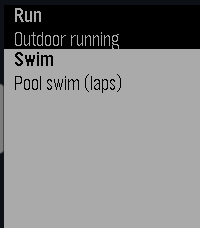

<!-- Generated by scripts/update_app_directory.py: do not edit by hand -->
[← All Pebble Developers](../developers.md)

# andrew

*1 app · Last updated 2026-10-11 · [About these lists](../about-app-lists.md)*

Links: [Rebble App Store](https://apps.rebble.io/en_US/developer/5899351a6d34e3ad97000250/1) · [GitHub (bruhdev1290)](https://github.com/bruhdev1290)

<h2 class="app-name" id="app-6951db4a91ea9d0009991d94"><a href="https://apps.rebble.io/en_US/application/6951db4a91ea9d0009991d94">sportsomatic</a> v1.1</h2>
<a class="app-source" href="https://github.com/bruhdev1290/sportsomatic" title="Source code" data-search-exclude>View source</a>

App · <a href="https://forum.rebble.io/t/379" title="Discuss this app on the Rebble forum" data-search-exclude>Forum thread</a>

No licence Released 2025-12-29 Updated 2026-03-27 Rebble App Store

Runs on: Round 2, Time 2, Pebble 2 Duo, Pebble 2, Time Round, Time, Classic

The app is designed to incorporate the sports features found in Timex Ironman and other triathlon watches, allowing users to track their sports data. It was developed using AI techniques and is…

