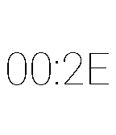

<!-- Generated by scripts/update_app_directory.py: do not edit by hand -->
[← All Pebble Developers](../developers.md)

# Andrew Codispoti

*1 watchface · Last updated 2026-10-11 · [About these lists](../about-app-lists.md)*

Links: [Pebble App Store](https://apps.repebble.com/apps/dev/andrew-codispoti_52f0480b1ac79491190011f1) · [GitHub (andrew749)](https://github.com/andrew749)

<h2 class="app-name" id="app-550e467ead788c03ba0000b7"><a href="https://apps.repebble.com/550e467ead788c03ba0000b7">0xFACE</a> v1.0</h2>
<a class="app-source" href="https://github.com/andrew749/0xFACE" title="Source code" data-search-exclude>View source</a>

Watchface

No licence Released 2015-03-22 Updated 2015-03-22

Runs on: Time 2, Pebble 2 Duo, Pebble 2, Time, Classic

A simple watch face which displays the time as a hexadecimal value.

