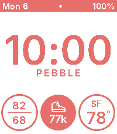

<!-- Generated by scripts/update_app_directory.py: do not edit by hand -->
[← All Pebble Developers](../developers.md)

# Andrew Ford

*1 watchface · Last updated 2026-10-12 · [About these lists](../about-app-lists.md)*

Links: [Pebble App Store](https://apps.repebble.com/apps/dev/andrew-ford_0719eed4ae8890bb0271f34b) · [GitHub (barefootford)](https://github.com/barefootford)

<h2 class="app-name" id="app-2799cd581c2a4bbbade7f3da"><a href="https://apps.repebble.com/2799cd581c2a4bbbade7f3da">Percival</a> v1.3.0</h2>
<a class="app-source" href="https://github.com/barefootford/Percival" title="Source code" data-search-exclude>View source</a>

Watchface

MIT Released 2026-04-07 Updated 2026-04-24

Runs on: Time 2

A clean watchface with rich customizable complications. Primary complications: - Current weather with city and temperature - Daily high/low temps - Sunrise or sunset time - Step count Accent…

