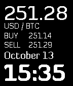

<!-- Generated by scripts/update_app_directory.py: do not edit by hand -->
[← All Pebble Developers](../developers.md)

# Andrew Nagle

*1 watchface · Last updated 2026-10-11 · [About these lists](../about-app-lists.md)*

Links: [Pebble App Store](https://apps.repebble.com/apps/dev/andrew-nagle_52b1f7fc05c046fdd100001e) · [GitHub (kabili207)](https://github.com/kabili207)

<h2 class="app-name" id="app-52b2344405c046123000009a"><a href="https://apps.repebble.com/52b2344405c046123000009a">BitWatcher</a> v1.6</h2>
<a class="app-source" href="https://github.com/kabili207/BitWatcher" title="Source code" data-search-exclude>View source</a>

Watchface

Released 2013-12-18 Updated 2016-09-28

Runs on: Round 2, Time 2, Pebble 2 Duo, Pebble 2, Time Round, Time, Classic

Displays the current price of bitcoin using BitcoinAverage price index. * Support for numerous currencies and exchanges * Currency average Donations: 14VNMYGQbaNZ4og3YmTMTpHs8zVsakrENB

