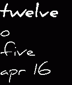

<!-- Generated by scripts/update_app_directory.py: do not edit by hand -->
[← All Pebble Developers](../developers.md)

# Andrew Varis

*1 watchface · Last updated 2026-10-12 · [About these lists](../about-app-lists.md)*

Links: [Pebble App Store](https://apps.repebble.com/apps/dev/andrew-varis_545aa6c32a5698fda50000aa) · [GitHub (ndrewv)](https://github.com/ndrewv)

<h2 class="app-name" id="app-552f772a26541fb9610000ae"><a href="https://apps.repebble.com/552f772a26541fb9610000ae">Text time</a> v1.5</h2>
<a class="app-source" href="https://github.com/ndrewv/text-watch-configurable" title="Source code" data-search-exclude>View source</a>

Watchface

Released 2015-04-16 Updated 2015-09-13

Runs on: Time 2, Pebble 2 Duo, Pebble 2, Time, Classic

A highly configurable text watch with your choice of fonts, alignment, date, background, animation speed and offset. Based off DHertz&#x27;s Words + Date watch.

